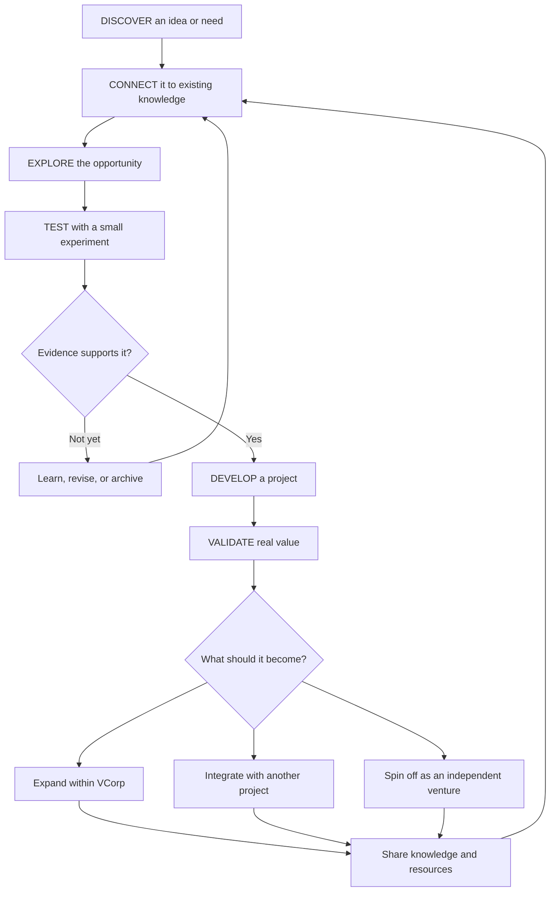

# 01 — HOW THE UNIVERSE WORKS
## A connected ecosystem, not a rigid corporate chart

VCorp uses a few shared functions. They may become teams, agents, projects, or legal entities later—but there is no need to create bureaucracy before it is useful.

| Domain | What it does |
|---|---|
| Intelligence Core | Coordinates priorities, plans, decisions, and shared context |
| Ventures | Develops business models, customers, revenue, and partnerships |
| Labs | Explores questions, prototypes, and experiments |
| Technology | Builds software, AI systems, and automation |
| Operations | Turns plans into reliable day-to-day execution |
| Capital | Tracks budgets, costs, resources, and reinvestment |
| Knowledge | Preserves documentation, lessons, and reusable methods |

## How work moves
An idea can enter from anywhere. It is recorded, connected to related work, explored, and tested. If evidence supports it, it becomes a project. A successful project may expand, become a venture, or eventually stand independently while remaining connected through shared knowledge.

## The growth cycle

## What keeps it coherent
Every project should have:
- A clear purpose and owner.
- A current status and next action.
- A record of important decisions.
- A place for its files and knowledge.
- A way to report results and problems.
- A clear relationship to the wider universe.

The structure is allowed to evolve. Changes should be documented so that growth does not erase the history or identity of the ecosystem.
